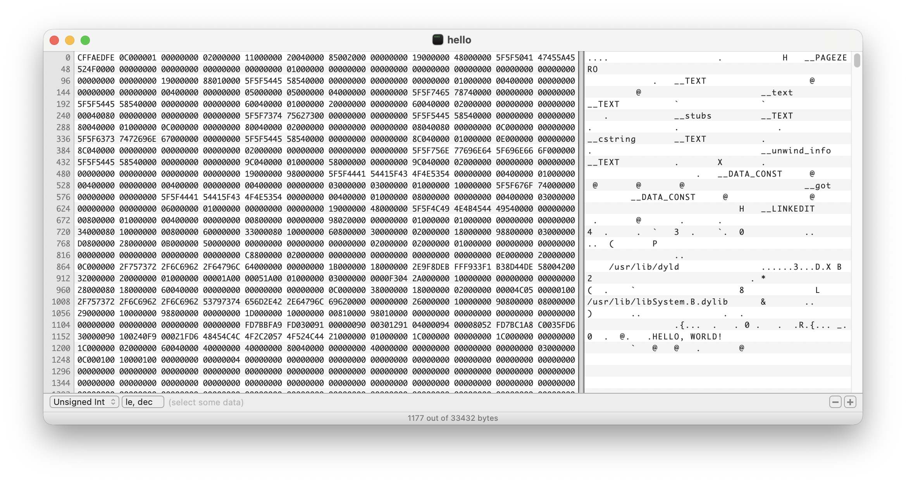

# #493 Hex Fiend

About Hex Fiend, an open source hex editor for macOS, with a test of using it to modify macOS executables.

## Notes

I think I first heard about Hex Fiend on the Unnamed Reverse Engineering Podcast.
Finally decided to check it out

Installation is straight-forward from the DMG.
A menu option installs cli support for `hexf`.

### Testing Binary Edit

Let's modify a binary, say [c/hello](../../c/hello/).
First let's compile and run the original program:

```sh
$ cd c/hello/
$ make clean
rm -f hello *.o
rm -fR *.dSYM
$ make
gcc -Wall -O3    hello.c   -o hello
$ ./hello
Hello, world.
$ strings -t x hello
48c Hello, world.
```

Now edit with Hex Fiend

```sh
hexf hello
```


Let's modify the strings, keeping the same string length to avoid issues with offsets etc.



After  save, we can find the modified string, but the OS refuses to run it because the signature is now invalid.

```sh
$ strings -t x hello
48c HELLO, WORLD!
$ ./hello
Killed: 9                  ./hello
$ codesign -vvv ./hello
./hello: invalid signature (code or signature have been modified)
In architecture: arm64
```

So let's resign to fix that:

```sh
$ codesign -s - hello
$ codesign -vvv ./hello
./hello: valid on disk
./hello: satisfies its Designated Requirement
$ ./hello
HELLO, WORLD!
```

Now running with our modified strings.

## Credits and References

* <https://hexfiend.com/>
* <https://github.com/HexFiend/HexFiend>
